# C4 Niveau 2 — Diagramme de conteneurs

Vue des microservices, bases de données, files de messages et brokers.

## Diagramme

```mermaid
flowchart TB
    subgraph clients["Clients"]
        web["Web App<br/>React 18 + TS + Vite"]
        mobile["Mobile App<br/>Flutter 3 + Riverpod"]
    end

    subgraph edge["Edge & Plateforme"]
        gw["API Gateway<br/>Spring Cloud Gateway<br/>(JWT verify)"]
        eureka["Service Discovery<br/>Eureka"]
        cfg["Config Server<br/>Spring Cloud Config"]
    end

    subgraph core["Microservices métier"]
        auth["auth-service<br/>(PG)"]
        userp["user-profile-service<br/>(PG + MinIO)"]
        cal["calendar-service<br/>(PG)"]
        price["pricing-service<br/>(PG)"]
        book["booking-service<br/>(PG)"]
        pay["payment-service<br/>(PG + audit append-only)"]
        chat["chat-service<br/>(Mongo + Redis)"]
        video["video-session-service<br/>(PG + MinIO)"]
        ai["ai-agent-service<br/>(PG + Redis cache)"]
        local["local-management-service<br/>(PG + MinIO)"]
        notif["notification-service<br/>(PG + Redis queue)"]
        admin["admin-dashboard-service<br/>(read-models)"]
    end

    subgraph data["Stockage & Bus"]
        kafka["Kafka<br/>(events)"]
        pg["PostgreSQL cluster<br/>(schémas par service)"]
        mongo["MongoDB<br/>(chat, logs)"]
        redis["Redis<br/>(cache, sessions, OTP)"]
        minio["MinIO<br/>(S3 — fichiers, photos, replays)"]
    end

    subgraph external["Services externes"]
        claude["Claude API"]
        livekit["LiveKit"]
        twilio["Twilio (SMS/WA)"]
        sg["SendGrid"]
        fcm["FCM"]
    end

    web --> gw
    mobile --> gw
    gw --> eureka

    gw --> auth & userp & cal & price & book & pay & chat & video & ai & local & notif & admin

    auth --> pg
    auth --> redis
    userp --> pg
    userp --> minio
    cal --> pg
    price --> pg
    book --> pg
    pay --> pg
    chat --> mongo
    chat --> redis
    video --> pg
    video --> minio
    video --> livekit
    ai --> pg
    ai --> redis
    ai --> claude
    local --> pg
    local --> minio
    notif --> redis
    notif --> twilio
    notif --> sg
    notif --> fcm
    admin --> pg

    auth -.events.-> kafka
    userp -.events.-> kafka
    book -.events.-> kafka
    pay -.events.-> kafka
    chat -.events.-> kafka
    video -.events.-> kafka
    cal -.events.-> kafka

    kafka -.consumes.-> notif
    kafka -.consumes.-> ai
    kafka -.consumes.-> admin

    cfg -.config.-> auth & userp & cal & price & book & pay & chat & video & ai & local & notif & admin & gw
```

## Inventaire des conteneurs

### Edge & Plateforme

| Conteneur | Tech | Rôle | Port |
|-----------|------|------|------|
| `api-gateway` | Spring Cloud Gateway | Routing, rate limit, JWT verify, CORS | 8080 |
| `service-discovery` | Eureka Server | Découverte de services | 8761 |
| `config-server` | Spring Cloud Config + Git/native backend | Config centralisée | 8888 |

### Microservices métier (14)

| # | Service | Port | DB | Kafka | Dépendances aval |
|---|---------|------|-----|-------|------------------|
| 1 | `auth-service` | 8101 | PG `auth_db` + Redis (OTP) | produces `auth.*` | twilio (OTP) |
| 2 | `user-profile-service` | 8102 | PG `profile_db` | produces `profile.*` | auth, minio |
| 3 | `calendar-service` | 8103 | PG `calendar_db` | produces `calendar.*` | booking (read), profile |
| 4 | `pricing-service` | 8104 | PG `pricing_db` | — | profile, ai (suggestion) |
| 5 | `booking-service` | 8105 | PG `booking_db` | produces `booking.*` | calendar, pricing, payment |
| 6 | `payment-service` ⚠️ | 8106 | PG `payment_db` (+ audit) | produces `payment.*` | booking, admin |
| 7 | `chat-service` | 8107 | Mongo + Redis | produces `chat.*` | ai (modération), booking |
| 8 | `video-session-service` | 8108 | PG + MinIO | produces `video.*` | booking, livekit |
| 9 | `ai-agent-service` | 8109 | PG + Redis | consumes `*.event` | claude API, profile, calendar |
| 10 | `local-management-service` | 8110 | PG + MinIO | produces `local.*` | profile, admin |
| 11 | `notification-service` | 8111 | Redis queue | consumes tous | twilio, sendgrid, fcm |
| 12 | `admin-dashboard-service` | 8112 | PG (read-models) | consumes tous | tous (read-only) |

### Stockages

| Stockage | Usage | Notes |
|----------|-------|-------|
| **PostgreSQL 16** | Données transactionnelles par service | Schémas isolés ; migrations Flyway |
| **MongoDB 7** | Messages chat, logs IA, replays metadata | Volume élevé en écriture |
| **Redis 7** | Sessions, OTP (TTL 5min), cache pricing, queue notifications | Cluster mode v2+ |
| **MinIO** | Fichiers : photos profils, diplômes PDF, replays vidéo, preuves de paiement, ressources marketplace | S3-compatible |
| **Kafka 3.6** | Bus d'événements (voir [events-catalog.md](./events-catalog.md)) | Topics partitionnés par `userId` ou `bookingId` |

## Communication inter-services

### Synchrone (REST via API Gateway)

Toutes les requêtes utilisateur passent par le gateway, sont authentifiées (JWT), puis routées. **Aucun service n'appelle directement un autre service en HTTP sans passer par le gateway en interne** (sauf pour les flux critiques low-latency : booking↔payment, ai↔profile/calendar).

Appels internes directs autorisés (service mesh-like, via Eureka) :
- `booking-service` → `payment-service` (escrow lock)
- `booking-service` → `calendar-service` (réservation créneau)
- `booking-service` → `pricing-service` (calcul prix)
- `ai-agent-service` → `user-profile-service` (lecture profils)
- `ai-agent-service` → `calendar-service` (lecture dispos)
- `admin-dashboard-service` → tous (lecture read-models)

### Asynchrone (Kafka)

Tous les événements métier émettent un message Kafka. Voir [events-catalog.md](./events-catalog.md) pour le détail.

Consommateurs systématiques :
- `notification-service` — déclenche notifications push/SMS/WA/email.
- `ai-agent-service` — alimente le modèle de recommandation, déclenche modération.
- `admin-dashboard-service` — alimente les read-models / KPIs.

## Sécurité réseau

- **Public** : Web (CloudFront/Cloudflare) → API Gateway.
- **Privé** : Tous les microservices + DB + Kafka dans un VPC privé, accessibles uniquement par le gateway et entre eux.
- **mTLS** entre services (v2+, via service mesh Istio ou Linkerd).
- **Secrets** : Vault ou AWS Secrets Manager ; jamais dans Git.
- **Rate limit** : 100 req/min/IP au gateway, 10 req/min sur endpoints sensibles (login, OTP).

## Observabilité (transversal)

- **Métriques** : Micrometer → Prometheus → Grafana.
- **Logs** : Logback JSON → Filebeat → Elasticsearch → Kibana.
- **Traces** : OpenTelemetry → Jaeger.
- **Healthchecks** : `/actuator/health` sur chaque service ; sondes K8s liveness + readiness.

## Déploiement

- **Local** : `docker-compose.yml` racine (tous les services + dépendances).
- **Dev/Staging/Prod** : Kubernetes via Helm charts (dans `infrastructure/k8s/`).
- **CI/CD** : GitHub Actions (build, test, scan, push image, déploiement Helm).
