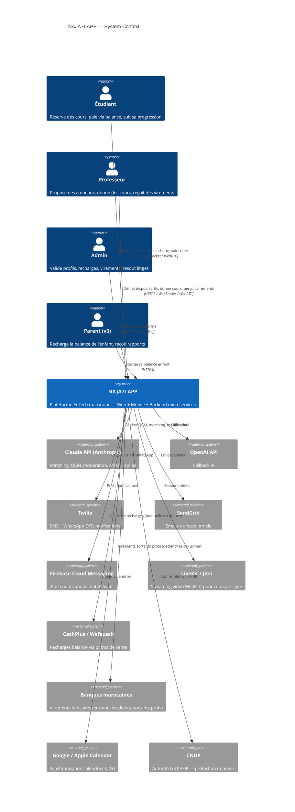

# C4 Niveau 1 — Diagramme de contexte

Vue de plus haut niveau : qui interagit avec NAJA7I-APP et quels systèmes externes sont impliqués.

## Diagramme

## Acteurs principaux

| Acteur | Rôle | Canaux | Auth |
|--------|------|--------|------|
| **Étudiant** | Recherche prof, réserve, paie, chatte, suit cours | Web + Mobile | OTP téléphone + JWT |
| **Professeur** | Définit tarifs/dispos, accepte séances, donne cours, demande virement | Web + Mobile | OTP + validation admin du profil |
| **Admin** | Valide profils, recharges, virements, modère litiges, KPIs | Web back-office | Email/password + 2FA obligatoire |
| **Parent** (v3) | Recharge balance enfant, lit rapports | Mobile + Web | OTP téléphone |
| **Agents IA Claude** | Matching, QCM, modération chat, smart-replies, AI Tutor | Interne | Service-to-service (API key) |

## Systèmes externes critiques

| Système | Usage | Criticité | Fallback |
|---------|-------|-----------|----------|
| **Claude API** | Toutes les fonctions IA | Haute | OpenAI API |
| **Twilio (SMS+WA)** | OTP, notifications urgentes | Critique | Email + push |
| **SendGrid** | Emails transactionnels | Moyenne | Resend, Mailgun |
| **FCM** | Push notifications | Haute | APNs direct (iOS) |
| **LiveKit/Jitsi** | Vidéo cours en ligne | Haute | Jitsi self-hosted |
| **CashPlus/Wafacash** | Recharges balance | Critique (revenu) | Virement bancaire manuel |
| **Google/Apple Calendar** | Sync calendrier | Faible (v2+) | Aucun (feature optionnelle) |

## Contraintes Maroc

- **Devise unique** : MAD (Dirham) — pas de multi-devise en v1.
- **Paiements** : pas de Stripe/PayPal pour les recharges étudiants (la grande majorité préfère cash/virement). Carte bancaire reportée à v2+ via CMI.
- **WhatsApp Business** : canal de communication dominant — à intégrer dès v1.
- **RTL Arabe** : interface bidirectionnelle obligatoire.
- **CNDP** : déclaration préalable obligatoire, DPO désigné, registre des traitements maintenu.
- **Calendrier scolaire** : rentrée septembre, BAC en juin → pics saisonniers à anticiper côté infra.
