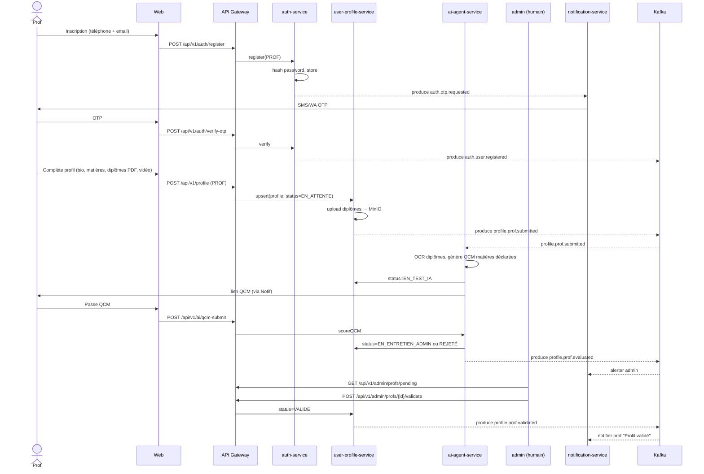
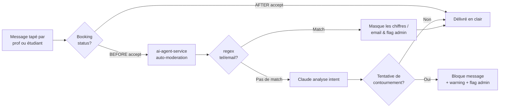
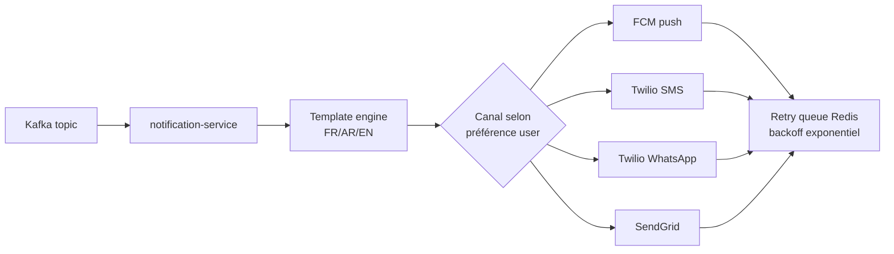
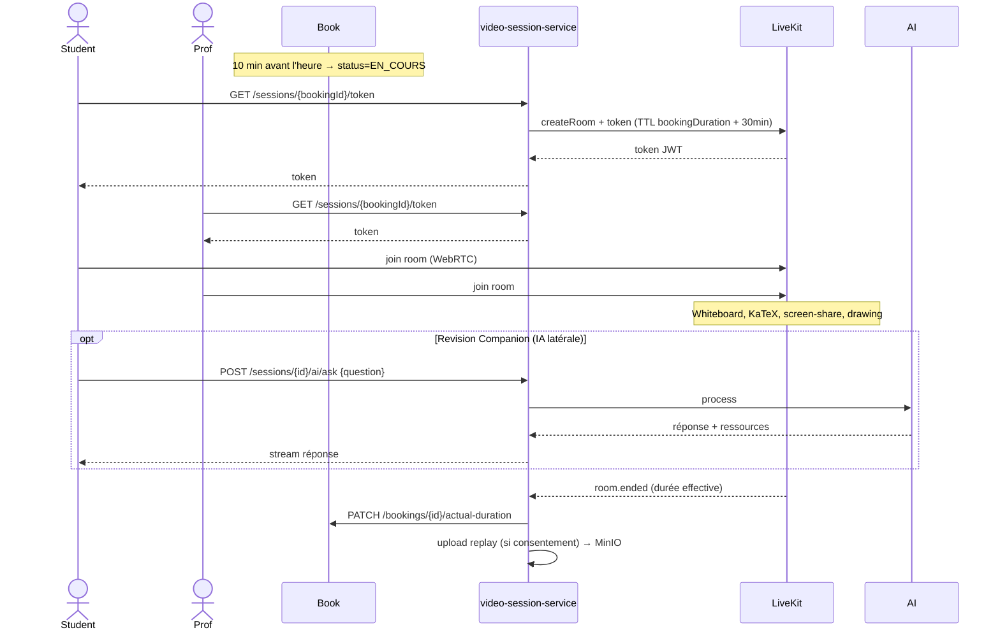

# Flux de données — Séquences métier critiques

Ce document décrit les flux critiques bout-en-bout, en particulier ceux qui touchent au **paiement (escrow)** et à l'**anti-contournement**.

## 1. Inscription et validation d'un professeur



**Points clés** :
- Le profil reste invisible aux étudiants tant qu'il n'est pas `VALIDÉ`.
- Le QCM filtre **avant** l'entretien admin pour économiser du temps humain.
- Les diplômes sont versionnés et conservés (audit anti-fraude).

## 2. Réservation & ESCROW — Flux critique paiement

```mermaid
sequenceDiagram
    actor Student
    actor Prof
    participant GW as API Gateway
    participant Book as booking-service
    participant Cal as calendar-service
    participant Price as pricing-service
    participant Pay as payment-service
    participant Chat as chat-service
    participant Notif
    participant Admin
    participant Kafka

    Note over Student: Prérequis : balance créditée (voir flux #3)

    Student->>GW: POST /api/v1/bookings (profId, slotId, modalité)
    GW->>Book: createBooking
    Book->>Cal: GET /slots/{id} (locked?)
    Cal-->>Book: slot disponible
    Book->>Price: GET prix(matière, niveau, modalité, durée)
    Price-->>Book: montant MAD
    Book->>Pay: POST /escrow/lock {studentId, amount}
    Pay->>Pay: vérifie balance ≥ amount
    Pay->>Pay: balance -= amount ; escrow += amount
    Pay->>Pay: append audit_log (immuable)
    Pay-->>Book: escrowId
    Book->>Cal: PATCH /slots/{id} status=RESERVED_PENDING
    Book->>Book: booking status=DEMANDÉE
    Book-->>Kafka: produce booking.requested

    Kafka-->>Notif: alerter prof
    Notif->>Prof: Push + WA "Nouvelle demande"

    alt Prof accepte (dans le délai)
        Prof->>GW: POST /api/v1/bookings/{id}/accept
        GW->>Book: accept
        Book->>Book: status=ACCEPTÉE_PAR_PROF
        Book->>Chat: open channel(prof, student)
        Book-->>Kafka: produce booking.accepted
        Note right of Chat: AVANT accept → chat IA-modéré, contact masqué<br/>APRÈS accept → contact dévoilé
        Kafka-->>Notif: notifier étudiant + révéler contact
    else Prof refuse ou TTL expire
        Prof->>GW: POST /api/v1/bookings/{id}/decline (ou TTL)
        Book->>Pay: POST /escrow/release {escrowId}
        Pay->>Pay: escrow -= amount ; balance += amount
        Pay-->>Book: OK
        Book->>Cal: PATCH /slots/{id} status=AVAILABLE
        Book->>Book: status=ANNULÉE
        Book-->>Kafka: produce booking.cancelled
    end

    Note over Student,Prof: --- Le cours a lieu ---

    Book->>Book: status=EN_COURS (heure début) → TERMINÉE (heure fin)

    alt Étudiant confirme
        Student->>GW: POST /api/v1/bookings/{id}/confirm
        Book->>Book: status=CONFIRMÉE
        Book-->>Kafka: produce booking.confirmed
        Note right of Pay: Escrow reste bloqué jusqu'à<br/>demande de virement du prof
        Pay->>Pay: marque escrow as RELEASABLE_TO_PROF
    else Étudiant ouvre litige
        Student->>GW: POST /api/v1/bookings/{id}/dispute
        Book->>Book: status=LITIGE
        Book-->>Kafka: produce booking.disputed
        Kafka-->>Notif: alerter admin
        Admin->>GW: POST /api/v1/admin/disputes/{id}/resolve {refund|payProf|split}
        Admin->>Pay: applique la décision
    end

    Note over Prof: Plus tard, le prof demande son virement

    Prof->>GW: POST /api/v1/payouts/request
    GW->>Pay: payoutRequest
    Pay-->>Kafka: produce payment.payout.requested
    Kafka-->>Notif: alerter admin

    Admin->>GW: POST /api/v1/admin/payouts/{id}/approve {refIBAN, montant}
    GW->>Pay: virement validé manuellement
    Pay->>Pay: escrow → 0 ; payouts++ ; audit_log
    Pay-->>Kafka: produce payment.payout.completed
    Notif->>Prof: "Virement émis"
```

**Garanties** :
- Le solde de l'étudiant ne peut jamais devenir négatif (vérif transactionnelle au moment du `escrow/lock`).
- Toute opération sur `balance`, `escrow`, `payouts` génère une ligne `audit_log` append-only (immuable).
- L'admin valide chaque virement sortant — pas de virement automatique en v1.
- En cas d'annulation après acceptation : **ticket admin obligatoire** (pas de remboursement auto).

## 3. Recharge de balance (étudiant)

```mermaid
sequenceDiagram
    actor Student
    participant GW
    participant Pay as payment-service
    participant Admin
    participant Notif

    Student->>Student: Paie via CashPlus / Virement / WA
    Student->>GW: POST /api/v1/topup (montant, méthode, preuve photo/PDF)
    GW->>Pay: createTopupRequest
    Pay->>Pay: status=EN_ATTENTE_ADMIN ; upload preuve MinIO
    Pay-->>Notif: alerter admin

    Admin->>GW: GET /api/v1/admin/topups/pending
    Admin->>GW: POST /api/v1/admin/topups/{id}/decide {approve|modify|reject}
    GW->>Pay: applyDecision
    alt Approve
        Pay->>Pay: balance += amount ; audit_log
        Pay-->>Notif: notifier étudiant "Balance créditée"
    else Reject
        Pay->>Pay: audit_log (refusé + motif)
        Pay-->>Notif: notifier étudiant "Recharge refusée"
    end
```

## 4. Anti-contournement — Chat avant acceptation



**Règles** :
- Avant `BOOKING_ACCEPTED` : email + numéro de téléphone du prof masqués dans le profil public ; messages filtrés.
- Patterns regex côté chat-service (rapide) + analyse Claude asynchrone (fond).
- 3 flags = compte suspendu, alerte admin.
- Après acceptation : contact dévoilé, filtrage levé.

## 5. Notifications multi-canal



Préférences utilisateur stockées dans `user-profile-service.notification_preferences`. Canal prioritaire au Maroc : **WhatsApp** > Push > SMS > Email.

## 6. Cours en ligne (vidéo) — séance type


